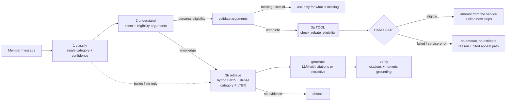

# SunGrid Copilot

A member-support copilot for **SunGrid Cooperative** (fictional solar co-op). It answers member questions from an internal knowledge base with **category-filtered hybrid RAG**, and routes personal eligibility questions to SunGrid's **eligibility service** behind a **hard gate**.

- **Part A** — ingestion (markdown-aware chunking → embeddings → Qdrant), a single-label query classifier, and the category used **only as a retrieval filter**.
- **Part B** — an explicit multi-step agent; the `check_rebate_eligibility` call is its own step and component; failed checks never get an amount or estimate.
- **Part C** — [`docs/DESIGN.md`](docs/DESIGN.md) (evaluation, scaling, new categories, trade-offs).
- Ambiguous document reasoning — [`docs/CATEGORY_DECISIONS.md`](docs/CATEGORY_DECISIONS.md).

Works **with any LLM provider or with none**: without an API key it runs fully offline (extractive, cited answers), so tests and CI need no secrets.

---

## Results at a glance

Golden set: 92 hand-written cases (single- and multi-turn), kept separate from the classifier's training queries (a test checks there is no overlap). Numbers below are from the **offline, no-LLM mode** (`reports/eval_report.md`), i.e. the floor of the system:

| Metric | Result |
|---|---|
| Hard-gate violations (amount/estimate leaked on a failed check) | **0** (+ 150-example property test) |
| Eligibility decision accuracy (tool vs. expected) | **100%** |
| Tool routing precision / recall | **100% / 100%** |
| Query classification accuracy | **97.1%** |
| Retrieval hit@4 | **100%** |
| Answer fact recall (offline extractive mode) | 91.4% |
| Latency p50 (offline) | ~10 ms |
| Tests | 124 passing (`pytest`), ruff clean |

---

## Quick start

Requires **Python 3.10+**.

```bash
# 1. install
git clone https://github.com/Imanimtiaz2001/sungrid-copilot.git
cd sungrid-copilot
python -m venv .venv && source .venv/bin/activate        # Windows: .venv\Scripts\activate
pip install -r requirements-dev.txt && pip install -e . --no-deps

# 2. configure (optional - skip to run fully offline)
cp .env.example .env        # then paste ONE key, e.g. ANTHROPIC_API_KEY=... or OPENAI_API_KEY=...

# 3. run
sungrid ingest                                   # builds the index (first run downloads bge-small, ~67 MB)
sungrid ask "How do I appeal a rebate decision?" --trace
sungrid chat --trace                             # multi-turn; try the eligibility flow below
```

Sample chat:

```text
you> Am I eligible for the rebate?
     -> asks for ZIP, income, system size, installer status (no tool call yet)
you> 94103, 6kW, income 80k
     -> asks only for the installer status
you> yes
     -> ✅ Eligible — estimated rebate $2,400.00 (from the eligibility service) + cited next steps
you> Actually my income is 125k
     -> ❌ Not eligible — "Household income exceeds the regional threshold." No amount, appeal path cited.
```

### All commands

| Command | What it does |
|---|---|
| `sungrid info` | Show resolved config (provider, model, embedder; no secrets) |
| `sungrid ingest [--force]` | Chunk + embed + index the KB (incremental; `--force` rebuilds) |
| `sungrid ask "..." [--trace] [--json]` | One question; `--trace` prints every agent step |
| `sungrid chat [--trace]` | Interactive multi-turn chat (`/trace`, `/reset`, `/quit`) |
| `sungrid eval [--strict]` | Golden-set evaluation → `reports/eval_report.md` (+ JSON) |
| `sungrid audit` | How a classifier sees each document (surfaces ambiguous docs) |
| `sungrid serve` | HTTP API: `POST /ask`, `GET /health`, docs at `/docs` |
| `python scripts/demo.py` | Scripted demo → `docs/DEMO_TRANSCRIPT.md` |
| `pytest` / `make lint` | Tests (offline, deterministic) / lint |

API example:

```bash
curl -s localhost:8000/ask -H 'content-type: application/json' \
  -d '{"query": "Am I eligible for the rooftop rebate? ZIP 94103, income 85k, 6 kW, approved installer", "session_id": "abc"}'
```

### Configuration (`.env`)

| Variable | Default | Notes |
|---|---|---|
| `LLM_PROVIDER` | `auto` | `auto` picks the first key found (Anthropic → OpenAI → Gemini → Groq); `none` = offline |
| `LLM_MODEL` | per provider | `claude-haiku-5-5`, `gpt-4o-mini`, `gemini-2.5-flash`, `llama-3.3-70b-versatile` |
| `ANTHROPIC_API_KEY` / `OPENAI_API_KEY` / `GEMINI_API_KEY` / `GROQ_API_KEY` | – | Set one. Gemini and Groq have free tiers |
| `LLM_BASE_URL`, `LLM_API_KEY` | – | Any OpenAI-compatible endpoint (`LLM_PROVIDER=openai_compatible`, e.g. Hugging Face router, Ollama) |
| `EMBEDDING_PROVIDER` | `auto` | `fastembed` (bge-small, local, free), `openai`, or `hashing` (no download) |
| `TOP_K` | `4` | Chunks passed to the answer step |

No key is ever committed: `.env` is git-ignored and only `.env.example` is in the repo.

---

## How it works



### Part A — ingestion, classification, retrieval

| Piece | Choice | Why |
|---|---|---|
| Chunking | One chunk per `##` section, prefixed with `doc title > section`; tables linearised into sentences; long sections sentence-packed with overlap | Sections are self-contained policy units; the header keeps short sections ("Appeals Process") tied to their document; table rows become quotable |
| Embeddings | `BAAI/bge-small-en-v1.5` via fastembed (local ONNX, free); OpenAI optional; deterministic hashing fallback | No key or GPU needed; never crashes on an offline machine |
| Vector store | Qdrant (embedded mode) | Native `MatchAny` filter over a **list** payload = multi-label documents; same client code runs against a Qdrant server at scale |
| Retrieval | BM25 + dense, fused with Reciprocal Rank Fusion; same filter on both | BM25 nails exact terms (fault codes "E07", "$0.40/watt"); dense handles paraphrase; RRF needs no score calibration |
| Classifier | Logistic regression on TF-IDF word + char n-grams (+ dense features when available), trained at start-up on seed queries, category descriptions and KB chunks; LLM adjudicates only low-margin cases | ~1 ms, free, deterministic, calibrated probabilities; the LLM is used only where it adds value |
| Category use | **Filter only.** Margin < 0.20 → filter widens to the top-2 categories; weak filtered evidence → unfiltered fallback (logged). Abstention is evidence-based, not classifier-based | A wrong label costs a little ranking quality, never a wrong pipeline or a refused in-domain question |

**Ambiguous document (`06_…rebate_billing_adjustments`):** documents are multi-label, queries single-label. Doc 06 is indexed once with `categories: [incentive_rebate, billing_account]` (primary: incentive) and is reachable from either filter. An independent audit (`sungrid audit`) shows a seed-only classifier also splits it ~51% / 38% between those two categories. Full reasoning: [`docs/CATEGORY_DECISIONS.md`](docs/CATEGORY_DECISIONS.md).

### Part B — agent and tool use

- **Explicit steps, recorded in `trace`:** `classify → understand → validate_arguments → tool_call → hard_gate → policy_lookup → gate_guard` (eligibility) or `classify → understand → retrieve → generate → verify` (knowledge). The tool call never runs inside retrieval, and retrieval never feeds the tool.
- **Stub kept as a fixed interface:** `src/sungrid_copilot/vendor/stub_tools.py` is byte-identical to the starter kit (a test checks its SHA-256). `agent/tools.py` wraps it: JSON schema derived from the stub's own signature, input validation, timeout, response-contract check, PII-redacted logging, **fail-closed** on any error.
- **Hard gate, enforced four ways:**
  1. Arguments are never guessed or defaulted; missing or uncertain values ("not sure if my installer is approved") → a clarifying question, not a tool call.
  2. Eligibility answers are **templated**, not LLM-written. A failed check shows the service's reason, no amount, and a note that the service stops at the first failed check.
  3. A `gate_guard` rejects any currency amount in a non-eligible answer except the member's own stated figures.
  4. Knowledge answers go through **numeric grounding**: any number not present in the retrieved text is rejected. This stops an LLM from calculating "6 kW × $0.40 = $2,400" outside the tool.
- **LLM proposes, code disposes:** the LLM may extract arguments (function-calling with the stub's schema), but each value must appear in the member's own words (`is_grounded`) or it is discarded.
- **Edge cases covered:** multi-turn slot filling and corrections, watts → kW, "$85k", monthly → annual income (with a visible note), kWh ≠ kW, lapsed installer certification = non-approved (per doc 07), the Battery Add-On gated on the rooftop decision, programs with no eligibility service (low-income credit, commercial) answered from documents with a disclaimer, and prompt-injection attempts.

---

## Evaluation and tests

- `sungrid eval` runs `data/eval/golden_set.jsonl` and reports: classification accuracy + confusion matrix; intent/tool routing; eligibility decisions; hard-gate violations; retrieval hit@k/MRR with a **filter ablation** (none / hard / soft+fallback / oracle); answer fact recall; abstention; latency; and the document category audit.
- `pytest` (124 tests) includes a **Hypothesis property test**: 150 random eligibility requests (with "just estimate it anyway" pressure). The decision must equal the stub's, and failed checks must contain no amount. It also runs the real OpenAI and Anthropic SDKs against a local fake server, so the provider code is tested without keys.
- CI (`.github/workflows/ci.yml`) runs lint, tests and `sungrid eval --strict`, which fails the build on a quality-gate regression.

## Project layout

```
config/            taxonomy.yaml (categories) · kb_manifest.yaml (doc → categories, rationale, cited follow-ups)
data/kb/           the 14 knowledge-base documents (unchanged)
data/classifier/   seed queries for the classifier
data/eval/         golden evaluation set
src/sungrid_copilot/
  ingestion/       chunker.py · pipeline.py (incremental, idempotent)
  embeddings.py    fastembed / openai / hashing
  store.py         Qdrant + chunk store
  retrieval.py     hybrid BM25 + dense, RRF, filter policy, evidence
  classifier.py    single-label classifier (+ LLM adjudication)
  agent/           copilot.py (orchestrator) · intent.py · slots.py · tools.py · compose.py · guards.py
  llm/             provider-agnostic client (OpenAI-compatible, Anthropic)
  vendor/          stub_tools.py — UNCHANGED third-party interface
  evaluation.py    golden-set harness · cli.py · api.py · factory.py
tests/             124 tests (unit, property, adapter, API, quality gates)
docs/              DESIGN.md (Part C) · CATEGORY_DECISIONS.md · DEMO_TRANSCRIPT.md
reports/           eval_report.md · eval_results.json
```

## Assumptions

1. **Eligibility scope.** The service checks the **Rooftop Rebate** only. Battery Add-On questions run the rooftop check first (doc 09 makes it a prerequisite); a pass shows the add-on terms from the documents but **no add-on amount**, because no service computes one. Low-income and commercial programs have no service, so they are answered from documents with a disclaimer.
2. **Personal vs. general.** "Am I eligible / how much would I get" → tool. "What are the eligibility rules / how much is the rate" → documents. When unsure, the router prefers the tool path, because a clarifying question is cheaper than an unchecked estimate.
3. **No defaults for tool arguments.** Unknown values are asked for, never assumed.
4. **Income.** Treated as the household's annual income in USD. Monthly figures are annualised and the conversion is shown to the member.
5. **The service's first-failure behaviour** is reported honestly. The agent does not probe the service with altered inputs to find other failures, since that would amount to re-implementing its logic.
6. **Sessions** are in-memory (LRU). Production would use Redis or similar.
7. **The KB is English markdown** with `#`/`##` structure. Other formats need a loader, not a new pipeline.

## Out of scope (stated, not skipped)

Authentication and member identity, a UI beyond the CLI and API, persistent conversation storage, a cross-encoder reranker, and online monitoring infrastructure. [`docs/DESIGN.md`](docs/DESIGN.md) describes how each would be added.
